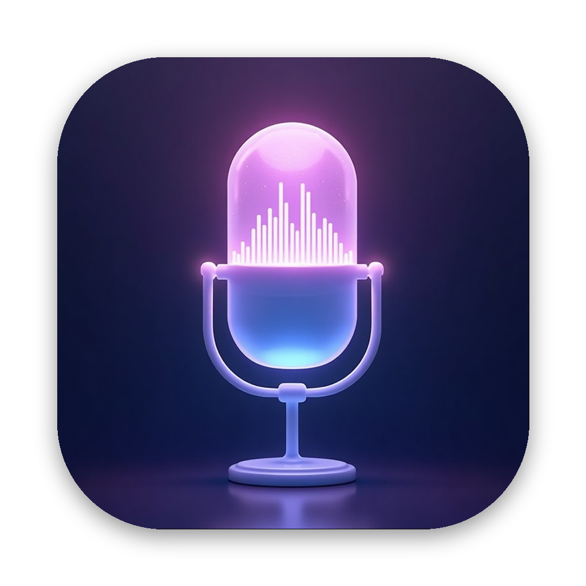
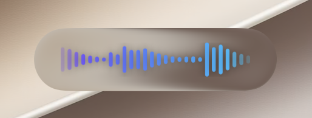

<div align="center">
  
  <h1>vlow</h1>
  <p><strong>Voice dictation for macOS that runs on your Mac.</strong></p>
  <br>
  
</div>

Double-tap a modifier key, speak, double-tap again, and the text is pasted
into the app you were in. Transcription runs on-device through MLX, so the
default setup needs no network and no API key. Apple Silicon only; tested on
macOS 26.

```bash
brew install --cask --no-quarantine mcurses/vlow/vlow
```

Or grab the `.dmg` from [Releases](https://github.com/mcurses/vlow/releases)
and drag it to Applications. The app bundles its own Python, MLX and overlay.
On first launch it opens Settings and asks you to download a model
(~2.5–3 GB, once).

## How it works

**Two gestures on one key.** A double-tap starts a batch recording: vlow
records until you double-tap again, transcribes the whole thing and pastes it
in one go. Holding the key streams instead, typing text as you speak. With
Parakeet selected, streaming runs on-device too.

**Local or cloud, chosen per recording.** With the backend set to *auto*,
short recordings are transcribed locally and anything over a threshold (60 s
by default) goes to AssemblyAI. You don't switch modes by hand.

**A queue instead of a busy hotkey.** When you stop a recording, it goes into
a queue and the hotkey is free again right away. Each pending transcription
shows up as a small glass blob next to the recording pill, and text is pasted
in the order you spoke it.

**Pasting into the app you started in.** A batch recording remembers which app
was in front when it began. If you switch to something else while it
transcribes, vlow pastes into the original app and then puts you back where
you were.

## Details

- **Two on-device models.** Whisper large-v3 for accuracy in a single
  language. Parakeet TDT v3 for speed (about 25× realtime, so a minute of
  speech takes two or three seconds) and for mixed German/English, which
  Whisper handles badly because it picks one language per 30-second window.
- **Known words.** A list of names and jargon that biases every backend: a
  prompt for Whisper, key terms for AssemblyAI, fuzzy post-correction for
  Parakeet.
- **Audio is saved first.** Every session writes its raw audio to disk before
  transcription starts, and quitting vlow mid-recording still saves what was
  captured. Re-run it later with `vlow transcribe`.
- **Native Settings window.** SwiftUI, no Save button; changes apply
  immediately. Hotkey, backend, models with download progress, API keys, known
  words, start at login.
- **Updates.** vlow checks GitHub Releases once a day. One click downloads the
  new version, replaces the app and relaunches.

> **About "no network":** that only holds for the on-device backend. In *auto*
> mode, recordings over the threshold are uploaded to AssemblyAI, and normal
> dictation goes past a minute fairly often. See
> [Configuration](docs/configuration.md#transcription-backends).

## Also a CLI

```bash
vlow transcribe interview.m4a > interview.txt
```

`vlow transcribe` takes anything ffmpeg can read, several files at a time, and
uses the same backend and known words as dictation. The same command also
controls the running app: `vlow status`, `vlow logs`, `vlow restart`. On first
launch vlow links itself into `~/.local/bin`, so no sudo is needed; see
[Usage](docs/usage.md#getting-vlow-on-your-path) if that folder isn't on your
`PATH`.

## Documentation

| | |
|---|---|
| [Usage](docs/usage.md) | Gestures, modes, the menubar, input devices, the CLI, recovery |
| [Configuration](docs/configuration.md) | Backends, models, AssemblyAI, known words, start-at-login, `config.toml` |
| [Troubleshooting](docs/troubleshooting.md) | Permissions, wedged app, logs, Gatekeeper |
| [Development](docs/development.md) | Running from source, building the DMG, releasing, repo layout |

## License

MIT — see [LICENSE](LICENSE).
